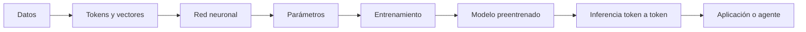
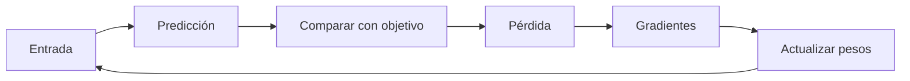

# ¿Cómo funciona realmente la inteligencia artificial?

*De una neurona artificial a los modelos de lenguaje y agentes inteligentes.*


## Una guía abierta para entender la IA

¿Cómo puede una computadora generar una respuesta a partir de millones de números? Este libro digital recorre el camino completo: datos, neuronas, parámetros, entrenamiento, modelos de lenguaje, inferencia, memoria, cuantización y agentes con herramientas.

La explicación distingue cuidadosamente entre analogías didácticas y el funcionamiento matemático. No depende de una marca, proveedor o modelo concreto.

## Recorrido rápido



## Índice

1. [¿Qué es la inteligencia artificial?](docs/01-que-es-ia.md)
2. [Desde cero: la neurona artificial](docs/02-neurona-artificial.md)
3. [¿Qué son los parámetros?](docs/03-parametros.md)
4. [¿Cómo se calcula el número de parámetros?](docs/04-calculo-de-parametros.md)
5. [¿Cómo aprende una red neuronal?](docs/05-entrenamiento.md)
6. [Datos, preentrenamiento y ajuste fino](docs/06-preentrenamiento.md)
7. [¿Qué es un modelo de lenguaje?](docs/07-modelos-de-lenguaje.md)
8. [Embeddings y representaciones numéricas](docs/08-embeddings.md)
9. [Transformers y mecanismos de atención](docs/09-transformers.md)
10. [¿Qué es un LLM?](docs/10-llm.md)
11. [¿Cómo genera una respuesta un LLM?](docs/11-inferencia.md)
12. [Memoria, contexto y conocimiento](docs/12-memoria-y-contexto.md)
13. [Precisión numérica, cuantización y memoria](docs/13-cuantizacion.md)
14. [¿Cómo se ejecuta un modelo?](docs/14-ejecucion-de-modelos.md)
15. [¿Qué significa que una IA razone?](docs/15-razonamiento.md)
16. [IA, modelo, LLM, chatbot, asistente y agente](docs/16-ia-llm-agentes.md)
17. [¿Cómo funciona un agente de IA?](docs/17-agentes.md)
18. [Experimentos prácticos](docs/18-experimentos.md)
19. [Preguntas frecuentes y mitos](docs/19-preguntas-frecuentes.md)
20. [Glosario y conclusiones](docs/20-glosario.md)

## Un ejemplo: contar parámetros

Una capa densa con 3 entradas y 4 neuronas tiene 12 pesos y 4 sesgos:

$$
\begin{aligned}
P &= (n_{\text{entrada}} \times n_{\text{salida}}) + n_{\text{salida}} \\
  &= (3 \times 4) + 4 = 16.
\end{aligned}
$$

El número no significa 16 respuestas almacenadas: son 16 valores ajustables que participan en muchas transformaciones.

## Un ejemplo: aprender



## Ejecutar los experimentos

Requiere Python 3.10 o posterior. Los ejemplos principales usan únicamente la biblioteca estándar:

```bash
python -m unittest discover -s tests -v
python ejemplos/neurona.py
python ejemplos/contar_parametros.py
python ejemplos/descenso_gradiente.py
```

## Licencia y contribuciones

Los textos originales se publican bajo [CC BY 4.0](LICENSE). Los ejemplos de código están bajo [MIT](LICENSE-CODE). Las contribuciones están descritas en [CONTRIBUTING.md](CONTRIBUTING.md). Las fuentes verificables se encuentran en [referencias/fuentes.md](referencias/fuentes.md).

## Idea central

Una IA no es sinónimo de un chatbot. Un modelo transforma números; una aplicación decide cómo presentarlo; un agente añade objetivos, herramientas, memoria, validaciones y permisos. Comprender esas capas permite evaluar mejor tanto sus capacidades como sus límites.
