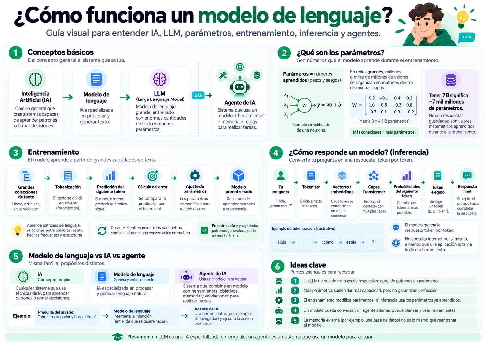
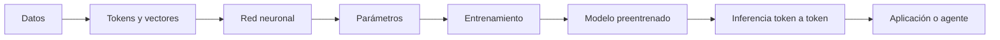
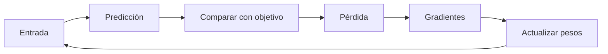

# ¿Cómo funciona realmente la inteligencia artificial?

*De una neurona artificial a los modelos de lenguaje y agentes inteligentes.*



## La guía abierta del Laboratorio de lo Imposible

¿Cómo puede una computadora generar una respuesta a partir de millones de números? Este libro digital recorre el camino completo: datos, neuronas, parámetros, entrenamiento, modelos de lenguaje, inferencia, memoria, cuantización y agentes con herramientas.

Esta guía está escrita para quien empieza desde cero. Cada idea avanza de la curiosidad a la intuición, el ejemplo, la fórmula, la práctica y la comprobación. Las simplificaciones declaran sus límites y el contenido no depende de una marca, proveedor o modelo concreto.

## Ruta de aprendizaje

1. **Nivel 1 — Conceptos básicos:** qué es IA y las matemáticas mínimas.
2. **Nivel 2 — Neuronas y parámetros:** redes, dimensiones y conteo.
3. **Nivel 3 — Entrenamiento:** datos, pérdidas, gradientes y tipos de aprendizaje.
4. **Nivel 4 — Modelos entrenados:** inicialización, checkpoints, preentrenamiento, fine-tuning y LoRA.
5. **Nivel 5 — Modelos de lenguaje:** tokens, embeddings, Transformers y LLM.
6. **Nivel 6 — Inferencia:** memoria, cuantización, ejecución y generación.
7. **Nivel 7 — Agentes:** herramientas, permisos, validación y supervisión.

## Recorrido rápido



## Índice por partes

### Parte I — Entender la inteligencia artificial

1. [¿Qué es realmente la inteligencia artificial?](docs/01-que-es-ia.md)
2. [Las matemáticas mínimas para entender una IA](docs/02-neurona-artificial.md)
3. [¿Cómo funciona una neurona artificial?](docs/03-parametros.md)
4. [¿Qué es una red neuronal?](docs/04-calculo-de-parametros.md)

### Parte II — Parámetros y aprendizaje

5. [¿Qué son realmente los parámetros?](docs/05-entrenamiento.md)
6. [¿Cómo se calcula el número de parámetros?](docs/06-preentrenamiento.md)
7. [¿Cómo aprende una máquina? Entrenamiento paso a paso](docs/07-modelos-de-lenguaje.md)
8. [¿De dónde obtiene los datos una IA?](docs/08-embeddings.md)
9. [Tipos de aprendizaje: supervisado, autosupervisado y más](docs/09-transformers.md)

### Parte III — Estados y entrenamiento de modelos

10. [¿Qué es un modelo sin entrenar?](docs/10-llm.md)
11. [¿Qué es un modelo parcialmente entrenado?](docs/11-inferencia.md)
12. [¿Qué es un modelo preentrenado?](docs/12-memoria-y-contexto.md)
13. [Ajuste fino, transferencia de aprendizaje y LoRA](docs/13-cuantizacion.md)
14. [Cómo entrenar un modelo propio: tutorial completo](docs/14-ejecucion-de-modelos.md)
15. [Entrenar un modelo de lenguaje pequeño](docs/15-razonamiento.md)

### Parte IV — Modelos de lenguaje

16. [¿Qué es un modelo de lenguaje?](docs/16-ia-llm-agentes.md)
17. [Tokens, embeddings y representaciones](docs/17-agentes.md)
18. [Transformers y mecanismo de atención, desde la intuición](docs/18-experimentos.md)
19. [¿Qué es un LLM y por qué su tamaño importa?](docs/19-preguntas-frecuentes.md)
20. [Inferencia: cómo genera una respuesta un modelo](docs/20-glosario.md)

### Parte V — Ejecución, memoria y agentes

21. [Cómo se almacena y ejecuta un modelo de IA](docs/21-ejecucion-y-memoria.md)
22. [Cuantización: por qué algunos modelos ocupan menos](docs/22-cuantizacion.md)
23. [Memoria, contexto, conocimiento y razonamiento](docs/23-memoria-razonamiento.md)
24. [IA, modelos, LLM, chatbots, asistentes y agentes](docs/24-sistemas-de-ia.md)
25. [Cómo funciona un agente de IA con herramientas](docs/25-agentes.md)

### Parte VI — Experimentación y consulta

26. [Laboratorio práctico y conclusiones](docs/26-laboratorio.md)

La [matriz de conceptos](docs/matriz-conceptos.md) explica cómo se relacionan las partes y sirve como mapa de repaso.

## Un ejemplo: contar parámetros

Una capa densa con 3 entradas y 4 neuronas tiene 12 pesos y 4 sesgos:

$$
\begin{aligned}
P &= (n_{\text{entrada}} \times n_{\text{salida}}) + n_{\text{salida}} \\
  &= (3 \times 4) + 4 = 16.
\end{aligned}
$$

El número no significa 16 respuestas almacenadas: son 16 valores ajustables que participan en muchas transformaciones.

## Un ejemplo: aprender



## Ejecutar los experimentos

Requiere Python 3.10 o posterior. Los ejemplos principales usan únicamente la biblioteca estándar:

```bash
python -m unittest discover -s tests -v
python ejemplos/neurona.py
python ejemplos/contar_parametros.py
python ejemplos/descenso_gradiente.py
python ejemplos/entrenar_modelo.py
python ejemplos/modelo_lenguaje_pequeno.py
python ejemplos/verificar_conceptos.py
python ejemplos/tutorial_entrenar_desde_cero.py
python ejemplos/bigramas_explicados.py
```

La versión opcional con PyTorch está en `ejemplos/entrenar_pytorch.py`; requiere instalar la dependencia por separado y no es necesaria para ejecutar las pruebas básicas.

## Licencia y contribuciones

Los textos originales se publican bajo [CC BY 4.0](LICENSE). Los ejemplos de código están bajo [MIT](LICENSE-CODE). Las contribuciones están descritas en [CONTRIBUTING.md](CONTRIBUTING.md). Las fuentes verificables se encuentran en [referencias/fuentes.md](referencias/fuentes.md).

## Idea central

Una IA no es sinónimo de un chatbot. Un modelo transforma números; una aplicación decide cómo presentarlo; un agente añade objetivos, herramientas, memoria, validaciones y permisos. Comprender esas capas permite evaluar mejor tanto sus capacidades como sus límites.
