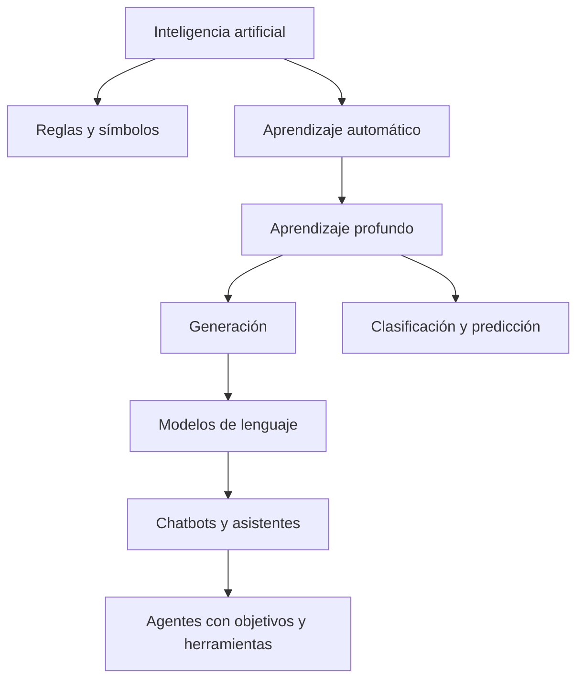
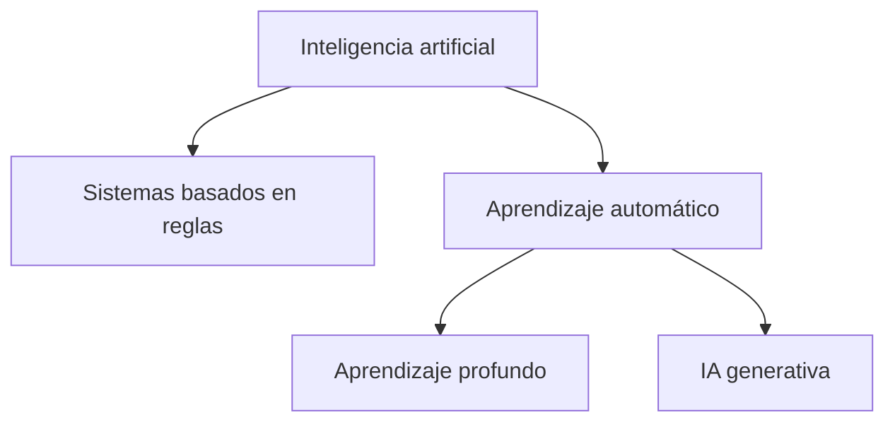

# 1. ¿Qué es realmente la inteligencia artificial?

## Idea sencilla

La inteligencia artificial (IA) es el campo que construye sistemas capaces de realizar tareas que asociamos con capacidades humanas, como clasificar, predecir, percibir, generar lenguaje o tomar decisiones. No es una sustancia ni una mente única: es un conjunto de métodos y sistemas.

Una analogía útil es una caja de herramientas. Un martillo, una regla y un robot pueden resolver problemas distintos; llamar a todo eso “IA” describe el campo, no una sola máquina.

## Un mapa de conceptos

La jerarquía no es absoluta: existen sistemas híbridos y modelos que combinan aprendizaje, búsqueda y reglas. No toda IA es una red neuronal, no toda red neuronal es un modelo de lenguaje y no todo modelo de lenguaje es un agente.

## Evolución breve

La IA pasó por periodos de razonamiento simbólico, sistemas expertos, métodos estadísticos y aprendizaje profundo. El cambio importante no fue que apareciera una “inteligencia” mágica, sino que aumentaron los datos, la capacidad de cómputo y la capacidad de optimizar modelos con muchos parámetros.

## Aprendizaje automático y profundo

En el aprendizaje automático, un programa ajusta un modelo a partir de ejemplos. En el aprendizaje profundo, el modelo contiene muchas capas de transformaciones diferenciables y aprende representaciones internas. “Profundo” describe la composición de capas, no una garantía de comprensión.

La IA discriminativa estima clases o valores: “¿es spam?” o “¿cuál es la temperatura?”. La generativa produce datos nuevos siguiendo patrones aprendidos: texto, imágenes o audio.

## Especializada y general

Una IA especializada optimiza una tarea o familia de tareas. La inteligencia artificial general es una idea de investigación y debate, no una categoría con una definición y prueba universalmente aceptadas. Conviene no presentar capacidades observables como conciencia o experiencia subjetiva.

## Errores frecuentes

- Confundir IA con un robot físico.
- Suponer que una salida fluida demuestra comprensión humana.
- Creer que “aprendizaje automático” significa que el sistema aprende durante cada conversación.
- Usar “algoritmo” y “modelo” como sinónimos: el algoritmo es el procedimiento; el modelo es el objeto ajustado.

## Resumen

IA es el campo amplio; aprendizaje automático aprende de datos; aprendizaje profundo usa redes de muchas capas; los modelos de lenguaje son una especialización; un agente es un sistema que puede usar modelos y herramientas para perseguir objetivos.

## Autoevaluación

1. ¿Por qué una calculadora con reglas puede formar parte de un sistema de IA sin ser una red neuronal?
2. ¿Qué diferencia hay entre generar y clasificar?
3. ¿Por qué un chatbot no es automáticamente un agente?

**Actividad:** clasifica un filtro de correo, un traductor y un robot aspirador según tarea, datos, modelo y herramientas.

[Siguiente: la neurona artificial →](02-neurona-artificial.md)
## La pregunta inicial

Cuando una bandeja separa spam, una app recomienda una canción o un teléfono reconoce una cara, ¿está “pensando” o está transformando datos con un procedimiento? La inteligencia artificial (IA) es el campo que construye sistemas capaces de realizar tareas que asociamos con percepción, predicción, lenguaje, decisión o acción.

La IA no es una técnica única. Un sistema basado en reglas puede usar IA sin aprendizaje profundo; un modelo de aprendizaje automático aprende regularidades a partir de datos; el aprendizaje profundo usa redes con muchas capas; la IA generativa produce contenido y la predictiva estima resultados. “Discriminativa” suele referirse a distinguir clases o estimar una decisión, mientras que “generativa” modela cómo producir ejemplos.

Un **modelo** es una función o estructura ajustada; un **sistema** incluye datos, modelo, interfaz, reglas y operación. Un filtro de correo puede combinar reglas y un clasificador entrenado. La analogía con una persona ayuda a preguntar, pero no demuestra conciencia ni comprensión humana.

## Ejemplo y comprobación

Clasifica “factura urgente” y “ganaste un premio” según palabras, remitente y ejemplos previos. Escribe qué parte sería una regla y qué parte podría aprenderse. La respuesta correcta depende del objetivo y de los datos, no solo del nombre “IA”.
