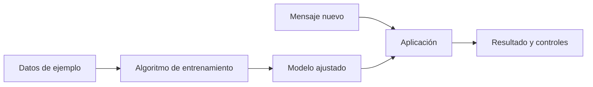
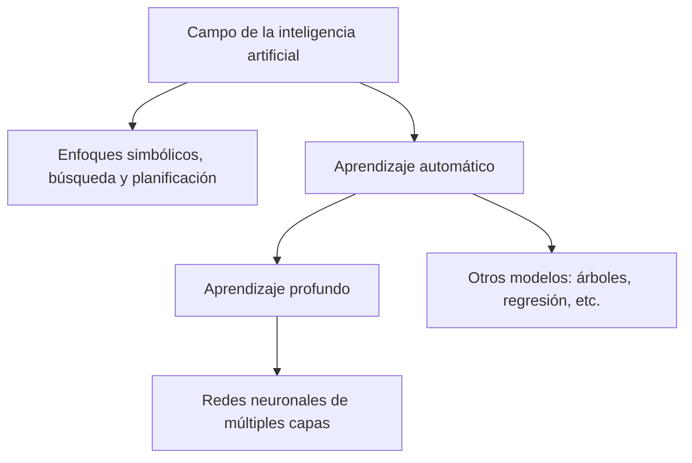

# 1. ¿Qué es realmente la inteligencia artificial?

> **La pregunta que guiará este capítulo:** cuando un teléfono reconoce una cara, una tienda recomienda un producto y un asistente escribe una respuesta, ¿están haciendo lo mismo?

**En una frase:** la inteligencia artificial (IA) es un campo de investigación e ingeniería dedicado a construir sistemas que realizan tareas asociadas con capacidades como percibir, inferir, predecir, utilizar lenguaje o tomar decisiones. **No es una sola tecnología ni implica, por definición, conciencia.**

## 1.1. Comencemos con tres situaciones cotidianas

Imagina que revisas tu correo electrónico:

1. Un mensaje que dice «Ganaste un premio, envía tus datos» aparece en la carpeta de correo no deseado.
2. Cuando escribes «Nos vemos ma…», el teclado te propone «mañana».
3. Le pides a un asistente que redacte una respuesta cordial y recibes un párrafo nuevo.

Los tres casos tienen relación con la IA, pero resuelven **problemas diferentes**. En el primero se **clasifica** un mensaje; en el segundo se **predice** una continuación; en el tercero se **genera** texto. No hace falta que los tres tengan el mismo algoritmo ni que funcionen con la misma clase de modelo.

**Una comparación útil:** «vehículo» es una categoría amplia. Una bicicleta, una motocicleta y un autobús no tienen el mismo mecanismo, aunque todos pueden transportar personas. De modo parecido, «IA» nombra un campo amplio, no una máquina con un funcionamiento universal.

La analogía tiene un límite: los distintos métodos de IA pueden solaparse y combinarse; sus fronteras no son compartimentos herméticos.

## 1.2. ¿Cuándo un programa usa reglas y cuándo aprende de ejemplos?

Supongamos que queremos identificar mensajes sospechosos.

**Opción A. Escribir una regla:** «si el asunto contiene la frase `premio gratis`, marca el correo para revisión». El programador decidió explícitamente esa condición. Si el mensaje dice «regalo especial», quizá la regla no lo detecte.

```python
# Ejemplo de una regla explícita, no de un modelo entrenado.
def revisar_asunto(asunto):
    return "premio gratis" in asunto.lower()

print(revisar_asunto("¡PREMIO GRATIS!"))  # True
print(revisar_asunto("Regalo especial"))  # False
```

**Opción B. Aprender de ejemplos:** reunimos mensajes y etiquetas como «deseado» o «no deseado». Un procedimiento de entrenamiento busca patrones útiles: ciertas palabras, combinaciones de expresiones, señales del remitente, etc. El modelo resultante podría detectar algunos mensajes que no contienen literalmente la frase de nuestra regla.

| Pregunta | Reglas explícitas | Aprendizaje automático |
|---|---|---|
| ¿De dónde sale el comportamiento? | De condiciones escritas por personas | De parámetros o estructuras ajustados a partir de datos |
| ¿Necesita entrenamiento? | No necesariamente | Sí, para aprender a partir de ejemplos o datos |
| ¿Puede equivocarse? | Sí | Sí |
| ¿Es fácil explicar una decisión? | A menudo, si las reglas son simples | Depende del tipo de modelo |

**Cuidado:** una regla sencilla no se convierte automáticamente en IA por aparecer en una aplicación. Hay sistemas de IA simbólica basados en reglas, búsqueda o representación de conocimiento, pero no toda condición `if` aislada merece llamarse inteligencia artificial. Además, los sistemas reales suelen **combinar reglas y modelos**.

## 1.3. Algoritmo, modelo y sistema: tres palabras distintas

Imagina una receta de pan:

- **Algoritmo:** el procedimiento, equivalente a los pasos de la receta.
- **Datos:** los ejemplos o mediciones que utilizamos.
- **Modelo:** la estructura y sus valores aprendidos; por ejemplo, una función capaz de estimar si un mensaje es correo no deseado.
- **Sistema de IA:** todo lo necesario para usar el modelo: interfaz, datos de entrada, reglas, permisos, servidores o dispositivo, herramientas y revisión de resultados.

La comparación de la receta ayuda, pero no es exacta: un modelo puede ser mucho más complejo que una receta y su entrenamiento puede incluir varios algoritmos.



Cuando alguien descarga «un modelo», normalmente recibe una arquitectura y unos valores numéricos aprendidos; eso no equivale a recibir una aplicación terminada.

## 1.4. El mapa: IA, aprendizaje automático y aprendizaje profundo

Hay tres conceptos que suelen confundirse:

**Inteligencia artificial (IA).** Es el campo general. Incluye, entre otros, razonamiento basado en reglas, búsqueda, planificación y técnicas de aprendizaje.

**Aprendizaje automático (*machine learning*, ML).** Es un conjunto de métodos que ajustan modelos utilizando datos, en lugar de especificar manualmente cada decisión posible. Por ejemplo, un sistema aprende a estimar un precio a partir de ejemplos de propiedades.

**Aprendizaje profundo (*deep learning*, DL).** Es una familia de métodos de aprendizaje automático basada en redes neuronales con múltiples capas de transformación. «Profundo» hace referencia a esas capas, no a que el sistema tenga pensamientos profundos.



El diagrama muestra **relaciones de inclusión habituales**, no afirma que todos los métodos de IA encajen limpiamente en un árbol. Existen sistemas híbridos.

### Un ejemplo común para reconocer los tres niveles

Queremos que una computadora ayude a distinguir fotografías de gatos y perros:

- Un enfoque basado en reglas intentaría describir rasgos mediante condiciones explícitas. En fotografías reales, esas reglas suelen resultar insuficientes.
- Un enfoque de aprendizaje automático entrenaría un clasificador con características y ejemplos etiquetados.
- Un enfoque de aprendizaje profundo podría entrenar una red neuronal para aprender representaciones visuales a partir de imágenes.

**El objetivo es similar; cambian los métodos.** Y ninguno garantiza respuestas correctas en todos los casos.

## 1.5. ¿Qué significan «clasificar», «predecir» y «generar»?

**Clasificar** es escoger una categoría. Pregunta: «¿Este comentario es positivo, negativo o neutral?».

**Predecir un valor** es estimar una cantidad. Pregunta: «¿Cuántas unidades podrían venderse la próxima semana?».

**Generar** es producir contenido, por ejemplo una descripción, un dibujo o un fragmento de audio, basándose en patrones aprendidos y la entrada disponible.

| Situación | Entrada | Salida esperada | Tipo de tarea |
|---|---|---|---|
| Correo sospechoso | Texto y otros datos del mensaje | «Posible spam» | Clasificación |
| Estimar consumo | Lecturas históricas | Un número aproximado | Predicción numérica |
| Escribir invitación | Instrucciones del usuario | Texto redactado | Generación |
| Reconocer voz | Señal de audio | Palabras transcritas | Reconocimiento |

**Precisión importante:** «generativo» y «discriminativo» son conceptos técnicos relacionados con objetivos de modelado; no todos los sistemas de predicción se pueden clasificar exhaustivamente con una etiqueta comercial como «IA predictiva». Algunos modelos combinan varias capacidades.

## 1.6. ¿Qué es la IA generativa?

Piensa en alguien que aprendió a escribir leyendo muchísimos textos. Si le solicitas una invitación para un cumpleaños, puede construir una invitación nueva sin tener una copia exacta guardada para cada cumpleaños imaginable.

Esta comparación ayuda a comprender la **IA generativa**: sistemas capaces de producir contenido a partir de regularidades aprendidas. Pueden generar texto, imágenes, sonidos, datos sintéticos y otros tipos de salida.

Pero hay dos advertencias:

1. **Generar algo convincente no significa que sea verdadero.** Un texto puede parecer seguro y contener errores.
2. **No necesariamente inventa desde cero.** Puede producir frases convencionales, reproducir patrones frecuentes o, en ciertas circunstancias, memorizar fragmentos del entrenamiento.

En capítulos posteriores estudiaremos cómo un **modelo de lenguaje** genera texto calculando probabilidades sobre unidades llamadas *tokens*.

## 1.7. ¿Dónde entran los modelos de lenguaje, los chatbots y los agentes?

Vamos a anticipar tres conceptos sin adelantarnos a sus detalles matemáticos:

- **Modelo de lenguaje:** modelo entrenado para trabajar con secuencias de lenguaje, por ejemplo estimando continuaciones. Existen modelos pequeños y grandes.
- **LLM (*large language model*):** modelo de lenguaje de gran escala. No hay una cifra universal de parámetros que defina qué cuenta como «grande».
- **Chatbot:** aplicación que conversa con una persona. Puede estar basada en reglas, en un modelo de lenguaje o en una combinación de componentes.
- **Agente de IA:** sistema que puede perseguir objetivos mediante decisiones y acciones, a menudo utilizando herramientas. Puede emplear un LLM, pero **no todos los agentes necesitan uno**.

**Ejemplo:** si escribes «abre el calendario», un modelo de lenguaje por sí solo puede explicarte cómo hacerlo. Una aplicación con permisos y herramientas apropiadas podría abrirlo. Para completar una tarea de varios pasos, el sistema tendría que planificar, ejecutar y verificar acciones: ahí aparecen capacidades típicas de un agente.

No confundamos **el modelo** con **la aplicación que lo utiliza**.

## 1.8. ¿La IA piensa o tiene conciencia?

Es razonable hablar informalmente de «pensar» cuando un sistema resuelve un problema, pero debemos diferenciar:

- **Comportamiento observable:** responder, razonar sobre un caso, reconocer un patrón o seguir una instrucción.
- **Mecanismo computacional:** operaciones sobre datos y representaciones, ejecutadas mediante algoritmos y hardware.
- **Conciencia o experiencia subjetiva:** cuestión filosófica y científica que no queda demostrada por una conversación fluida.

No hay que atribuir sentimientos, intención humana o conciencia a un sistema únicamente porque redacta como una persona. Tampoco hace falta resolver esas preguntas filosóficas para estudiar matemáticamente cómo funciona.

## 1.9. Curiosidades que conviene recordar

**¿Una calculadora es IA?** Una calculadora básica efectúa operaciones determinadas y normalmente no se considera IA. Sin embargo, un programa de razonamiento simbólico puede utilizar operaciones aritméticas como parte de un sistema de IA más amplio.

**¿Todas las IA están en Internet?** No. Muchos modelos pueden ejecutarse localmente, aunque ciertas aplicaciones dependen de servidores o servicios externos.

**¿Una IA aprende mientras la uso?** No necesariamente. En numerosos sistemas los parámetros permanecen fijos durante el uso; recibir una entrada y producir una salida se llama *inferencia*. Guardar el historial de una conversación tampoco implica modificar esos parámetros.

**¿Más grande significa mejor?** No siempre. Importan los datos, la arquitectura, el entrenamiento, la evaluación y la tarea concreta.

## 1.10. Actividad guiada: identifiquemos el sistema

Analiza una aplicación imaginaria de correo electrónico que:

1. Bloquea mensajes de direcciones que el usuario agregó manualmente a una lista.
2. Clasifica mensajes con un modelo entrenado utilizando ejemplos.
3. Propone una respuesta redactada para un mensaje importante.

**Pregunta A.** ¿Cuál función utiliza una regla explícita? **Solución:** la primera, porque compara con una lista definida por el usuario.

**Pregunta B.** ¿Cuál utiliza aprendizaje automático? **Solución:** la segunda, si efectivamente el clasificador ajustó su comportamiento con ejemplos.

**Pregunta C.** ¿Cuál es generativa? **Solución:** la tercera, si crea texto a partir de una entrada y patrones aprendidos.

**Pregunta D.** ¿Todo el programa es un solo modelo? **Solución:** no. Es un sistema con funciones, reglas y posiblemente distintos modelos.

### Autoevaluación

1. **¿Por qué no es correcto decir que «IA» significa «LLM»?** Porque LLM es un tipo de modelo de lenguaje dentro del panorama más amplio de la IA.
2. **¿Cuál es la diferencia entre entrenamiento e inferencia?** Entrenar suele ajustar parámetros utilizando datos; inferir utiliza un modelo para producir una salida ante una entrada nueva.
3. **¿Por qué un chatbot no es automáticamente un agente?** Porque conversar no implica poder ejecutar, observar y verificar acciones mediante herramientas.
4. **¿Puede una IA equivocarse aunque su respuesta suene convincente?** Sí; la fluidez del resultado no garantiza su exactitud.

## 1.11. Resumen: la idea que debes llevarte

La IA no es una máquina mágica ni una sola técnica. Es un conjunto de enfoques para construir sistemas capaces de resolver tareas como reconocer, predecir, generar o actuar. Dentro de este campo, el aprendizaje automático ajusta modelos a partir de datos; el aprendizaje profundo utiliza redes neuronales de múltiples capas. Una aplicación puede combinar modelos, reglas y herramientas.

**Conexión con el capítulo siguiente:** para descubrir cómo una red puede aprender, necesitamos unas pocas herramientas matemáticas. No hace falta ser experto: comenzaremos por cambiar números en una fórmula y terminaremos leyendo vectores y matrices con confianza.

[Siguiente: 2. Las matemáticas mínimas para entender una IA →](02-neurona-artificial.md)

## Fuentes para profundizar

- Russell, S. y Norvig, P. *Artificial Intelligence: A Modern Approach* (4.ª ed.). [Sitio del libro](https://aima.cs.berkeley.edu/).
- Goodfellow, I., Bengio, Y. y Courville, A. *Deep Learning* (2016), capítulo 1. [Libro de acceso abierto](https://www.deeplearningbook.org/).
- [Documentación de scikit-learn: aprendizaje supervisado](https://scikit-learn.org/stable/supervised_learning.html).

> Estas fuentes amplían los conceptos del capítulo. Los ejemplos del correo, precios y aplicaciones son construcciones didácticas, no resultados experimentales reportados por esas fuentes.
