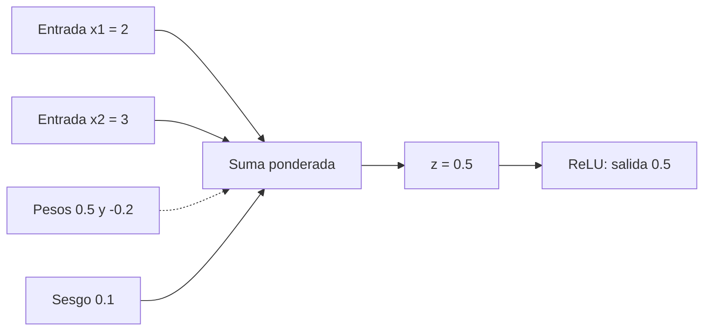

# 2. Las matemáticas mínimas para entender una IA

> **¿Por qué un modelo que conversa con personas necesita multiplicar números?** Porque una computadora procesa representaciones numéricas mediante operaciones. Antes de estudiar una neurona artificial, aprenderemos a interpretar esas operaciones con ejemplos cotidianos.

Este capítulo no pretende sustituir un curso de matemáticas. Su misión es darte las herramientas necesarias para **leer y comprobar** las fórmulas que aparecerán en los capítulos sobre neuronas, entrenamiento y modelos de lenguaje.

## 2.1. Una fórmula es una receta que podemos calcular

Imagina una papelería que vende cuadernos a 20 pesos cada uno. El precio depende de cuántos compres:

| Cuadernos | Operación | Total |
|---:|---|---:|
| 1 | 20 × 1 | 20 pesos |
| 2 | 20 × 2 | 40 pesos |
| 3 | 20 × 3 | 60 pesos |

Podríamos escribir tres operaciones, pero resulta más práctico representar todas con una sola regla:

$$
y=20x
$$

- $x$ = cantidad de cuadernos.
- $20$ = precio fijo de cada cuaderno.
- $y$ = total por pagar.

Si compras cuatro, sustituimos $x$ por 4:

$$
\begin{aligned}
y&=20x\\
y&=20\times4\\
y&=80
\end{aligned}
$$

**Eso es una función:** una regla que transforma una entrada en una salida. Aquí cada cantidad de cuadernos produce un precio correspondiente.

### ¿Y si hay un cargo fijo?

Supongamos que además cobran 10 pesos por el envío. La regla se convierte en:

$$
y=20x+10
$$

Para tres cuadernos:

$$
\begin{aligned}
y&=20(3)+10\\
 &=60+10\\
 &=70
\end{aligned}
$$

La función tiene una parte que depende de $x$ y otra que se agrega siempre.

## 2.2. Variables, constantes y parámetros: no son lo mismo

La palabra **variable** indica que un símbolo puede tomar distintos valores; una **constante** tiene un valor fijado en el problema considerado.

En $y=20x+10$, la cantidad de cuadernos $x$ cambia de una compra a otra, mientras que el precio de 20 y el cargo de 10 permanecen fijos en ese ejemplo.

Ahora podemos escribir una regla más general:

$$
y=wx+b
$$

- $x$ es la entrada.
- $y$ es la salida.
- $w$ multiplica la entrada.
- $b$ es el valor que se suma.

En el ejemplo de los cuadernos, $w=20$ y $b=10$.

**¿Por qué usamos letras en vez de escribir siempre 20 y 10?** Porque quizá deseamos ajustar esos valores. En un modelo de aprendizaje automático, números como $w$ y $b$ pueden ser **parámetros entrenables**. Es decir, un procedimiento de entrenamiento puede ir modificándolos para mejorar las predicciones.

**No confundas:** una entrada $x$ cambia porque llega un dato nuevo; un parámetro $w$ cambia durante el entrenamiento porque se ajusta el modelo. A menudo, durante el uso habitual del modelo, $w$ permanece fijo.

## 2.3. Números positivos y negativos

Imagina el dinero de una cuenta:

- Depositar 50 pesos representa $+50$.
- Retirar 20 pesos representa $-20$.

Si comenzamos con cero, el saldo será:

$$50+(-20)=30$$

Los números negativos también pueden aparecer como pesos de una neurona. Un peso positivo contribuye en una dirección; uno negativo puede restar valor a la suma. **Eso no implica por sí solo que una característica sea «buena» o «mala».** Su significado depende de la tarea y del resto del modelo.

Ejemplo:

$$
\begin{aligned}
z&=(2\times0.5)+(3\times-0.2)\\
 &=1-0.6\\
 &=0.4
\end{aligned}
$$

La primera entrada aporta $1$ y la segunda aporta $-0.6$.

## 2.4. Fracciones, decimales y porcentajes

Una fracción como $\frac{1}{2}$ representa una parte de un total. También podemos escribirla como $0.5$ o $50\%$.

Si un artículo de 200 pesos tiene un descuento del 25 %, primero calculamos el descuento:

$$200\times0.25=50$$

Después lo restamos:

$$200-50=150$$

Otra forma es multiplicar directamente por la proporción que queda:

$$200\times(1-0.25)=200\times0.75=150$$

Este tipo de transformaciones nos ayuda a leer números entre 0 y 1, que aparecerán cuando estudiemos probabilidades y ciertas funciones de activación.

## 2.5. Potencias y notación científica

Una potencia es una multiplicación repetida:

$$2^3=2\times2\times2=8$$

Una potencia de diez ayuda a escribir cantidades grandes:

$$10^6=1\,000\,000$$

Podemos expresar 1.5 millones como:

$$1.5\times10^6=1\,500\,000$$

En los tamaños de modelos encontrarás con frecuencia abreviaturas como M (millones) y B (miles de millones, del inglés *billion*):

$$1\text{ B}\approx10^9=1\,000\,000\,000$$

La cifra de parámetros de un modelo no indica cuántas palabras sabe ni cuántas preguntas puede responder; aprenderemos a contarla en el capítulo 6.

## 2.6. La sumatoria: una manera corta de escribir muchas sumas

Supongamos que obtuviste cuatro calificaciones: 8, 9, 7 y 10. Para sumarlas:

$$8+9+7+10=34$$

En matemáticas podemos usar el símbolo $\sum$ (sigma mayúscula) para indicar «suma los elementos».

$$
\sum_{i=1}^{4}x_i=x_1+x_2+x_3+x_4
$$

Aquí:

- $\sum$ significa sumar.
- $i$ es un contador que recorre posiciones.
- $i=1$ indica dónde comienza.
- El 4 arriba señala dónde termina.
- $x_i$ representa el elemento en la posición $i$.

Si $x_1=8$, $x_2=9$, $x_3=7$ y $x_4=10$, el resultado es 34.

Para obtener el promedio:

$$
\bar x=\frac{8+9+7+10}{4}=\frac{34}{4}=8.5
$$

**¿Para qué sirve en IA?** Una neurona puede recibir muchas entradas. Escribir $w_1x_1+w_2x_2+\cdots+w_nx_n$ ocupa espacio. Una sumatoria permite representar la misma operación de forma compacta.

## 2.7. Vectores: listas ordenadas de números

Imagina que un producto tiene tres características:

- Precio: 100 pesos.
- Peso: 2 kilogramos.
- Calificación promedio: 4 estrellas.

Podemos escribir esos valores como un **vector**:

$$\mathbf{x}=[100,\ 2,\ 4]$$

Un vector es una colección **ordenada** de componentes. Su posición importa: $[100,2,4]$ no representa lo mismo que $[4,100,2]$ si cada posición tiene una interpretación definida.

En estos ejemplos los valores tienen unidades distintas, y por eso no conviene sumarlos sin pensar. Los sistemas reales suelen normalizar o transformar características cuando hace falta.

### Sumar vectores

Supongamos dos desplazamientos sobre un mapa, medidos en metros:

$$\mathbf{a}=[2,3],\qquad \mathbf{b}=[4,1]$$

Para sumarlos, sumamos sus componentes correspondientes:

$$
\begin{aligned}
\mathbf{a}+\mathbf{b}
&=[2+4,\ 3+1]\\
&=[6,4]
\end{aligned}
$$

En una red neuronal, los vectores pueden representar entradas, activaciones y otras cantidades intermedias.

## 2.8. Producto escalar: multiplicar componentes y sumar

Imagina que un pequeño negocio vende:

- 2 lápices de 5 pesos.
- 3 libretas de 20 pesos.

Podemos organizar cantidades y precios así:

$$
\mathbf{q}=[2,3],\qquad\mathbf{p}=[5,20]
$$

Para calcular el total, multiplicamos cantidades por precios y sumamos:

$$
\begin{aligned}
\mathbf{q}\cdot\mathbf{p}
&=(2\times5)+(3\times20)\\
&=10+60\\
&=70
\end{aligned}
$$

Esta operación se llama **producto escalar** (*dot product*). Convierte dos vectores compatibles en un número.

En general:

$$
\mathbf{a}\cdot\mathbf{b}=\sum_{i=1}^{n}a_i b_i
$$

Los vectores deben tener el mismo número de componentes para esta expresión.

**Conexión con una neurona:** una neurona combina un vector de entradas y otro de pesos con un producto escalar, después añade un sesgo.

## 2.9. Matrices: tablas de números que permiten muchas operaciones juntas

Una **matriz** es un arreglo rectangular de valores, organizado en filas y columnas.

Supongamos una tabla con dos estudiantes y tres calificaciones:

$$
X=\begin{bmatrix}
8&9&7\\
10&8&9
\end{bmatrix}
$$

La matriz $X$ tiene **2 filas y 3 columnas**. Su tamaño se escribe $2\times3$.

No significa que la matriz «valga seis». Significa que contiene seis entradas numéricas.

### Multiplicar una matriz por un vector

Supongamos ahora:

$$
W=\begin{bmatrix}
2&1\\
-1&3
\end{bmatrix},\qquad
\mathbf{x}=\begin{bmatrix}4\\5\end{bmatrix}
$$

$W$ es de tamaño $2\times2$ y $\mathbf{x}$ es de tamaño $2\times1$. Podemos multiplicarlos porque el número de columnas de $W$ coincide con el número de filas de $\mathbf{x}$.

Calculamos una salida por cada fila:

$$
\begin{aligned}
\mathbf{y}=W\mathbf{x}
&=\begin{bmatrix}
2(4)+1(5)\\
-1(4)+3(5)
\end{bmatrix}\\
&=\begin{bmatrix}
8+5\\-4+15
\end{bmatrix}\\
&=\begin{bmatrix}13\\11\end{bmatrix}
\end{aligned}
$$

**Verificación de dimensiones:** $(2\times2)(2\times1)$ produce $(2\times1)$.

Esta idea resulta esencial para comprender las redes neuronales: muchas neuronas pueden calcular sus salidas utilizando una multiplicación de matrices, en vez de escribir una operación independiente para cada una.

### Un conteo que retomaremos después

Si una capa tiene 3 entradas y 4 neuronas totalmente conectadas, necesita una matriz de pesos con 4 filas y 3 columnas:

$$
W\in\mathbb{R}^{4\times3}
$$

Esto significa que $W$ contiene números reales organizados en $4\times3$ posiciones: **12 pesos**. Si cada una de las 4 neuronas añade un sesgo, existen además 4 valores de sesgo, para un total de 16 parámetros. Desarrollaremos este cálculo desde cero en el capítulo 6.

## 2.10. Probabilidad: medir incertidumbre

Imagina una bolsa con diez fichas: siete verdes y tres azules. Si sacamos una ficha al azar, suponiendo que todas tienen la misma probabilidad de salir:

$$
P(\text{verde})=\frac{7}{10}=0.7=70\%
$$

La letra $P$ representa «probabilidad».

En este caso:

$$
P(\text{azul})=\frac{3}{10}=0.3=30\%
$$

Y como las dos opciones cubren todos los resultados posibles:

$$0.7+0.3=1$$

### ¿Qué es una probabilidad condicional?

Imagina que ahora sabes que la ficha extraída pertenece a un subconjunto de cinco fichas, de las cuales cuatro son verdes. Si todas las fichas de ese subconjunto son igualmente probables, la probabilidad de verde **dado ese nuevo dato** es:

$$P(\text{verde}\mid\text{subconjunto})=\frac45=0.8$$

La barra vertical $\mid$ se lee «dado que» o «condicionado a».

Más adelante, los modelos de lenguaje utilizarán probabilidades de continuaciones condicionadas al texto anterior. Las probabilidades que produce un modelo se calculan matemáticamente; no siempre están perfectamente calibradas respecto a la realidad.

## 2.11. Funciones de pérdida: una medida del error

Imagina una máquina que intenta estimar una temperatura. El valor correcto es 30 °C, pero predice 27 °C.

Su error con signo sería:

$$27-30=-3$$

Si queremos una medida no negativa que penalice las diferencias, podemos elevar ese error al cuadrado:

$$
L=(\hat y-y)^2
$$

En esta expresión:

- $L$ = pérdida o error cuantificado.
- $\hat y$ = predicción del modelo; el «sombrerito» indica valor estimado.
- $y$ = valor esperado.

Sustituyendo:

$$
\begin{aligned}
L&=(27-30)^2\\
&=(-3)^2\\
&=9
\end{aligned}
$$

La pérdida cuadrática no se mide directamente en °C, sino en °C². Otras tareas utilizan otras funciones de pérdida. No es una escala universal de calidad.

**¿Para qué sirve?** Para disponer de un objetivo cuantitativo que el entrenamiento intenta reducir.

## 2.12. Derivadas: ¿en qué dirección cambia el resultado?

Imagina que subes una colina. Si avanzas un metro y la altura aumenta, vas cuesta arriba. Si disminuye, vas cuesta abajo.

La **derivada** expresa cómo cambia una cantidad cuando cambia ligeramente otra. Matemáticamente, para una función suave, es la pendiente local.

Veamos una función sencilla:

$$f(w)=(w-2)^2$$

| Valor de $w$ | $f(w)$ |
|---:|---:|
| 0 | 4 |
| 1 | 1 |
| 2 | 0 |
| 3 | 1 |
| 4 | 4 |

La función es mínima cuando $w=2$.

Su derivada es:

$$f'(w)=2(w-2)$$

Si $w=0$:

$$f'(0)=2(0-2)=-4$$

El valor negativo significa que, en ese punto, incrementar ligeramente $w$ tiende a **reducir** el valor de la función. Si $w=4$, la derivada es positiva, indicando que incrementar $w$ tiende a **aumentarla**.

### ¿Cómo se calcula una derivada tan sencilla?

Usamos dos reglas que aquí tomamos como herramientas:

1. La derivada de $u^2$ respecto de $u$ es $2u$.
2. Si $u=w-2$, su derivada respecto de $w$ es 1.

Por la regla de la cadena:

$$
\frac{d}{dw}(w-2)^2=2(w-2)\times1
$$

En el capítulo de entrenamiento aprenderemos a utilizar estas pendientes para ajustar parámetros.

## 2.13. Gradientes: muchas pendientes para muchos parámetros

Si solo tenemos un parámetro $w$, una derivada puede indicar cómo cambia la pérdida al modificarlo.

¿Y si tenemos dos parámetros, $w$ y $b$?

Podemos definir:

$$
L(w,b)=(w-2)^2+(b-1)^2
$$

Ahora necesitamos dos derivadas parciales:

$$
\frac{\partial L}{\partial w}=2(w-2),\qquad
\frac{\partial L}{\partial b}=2(b-1)
$$

El símbolo $\partial$ indica una derivada respecto de una variable mientras las demás se mantienen fijas.

El **gradiente** reúne ambas:

$$
\nabla L=\begin{bmatrix}
\frac{\partial L}{\partial w}\\[4pt]
\frac{\partial L}{\partial b}
\end{bmatrix}
$$

Si $w=0$ y $b=0$:

$$
\nabla L=\begin{bmatrix}-4\\-2\end{bmatrix}
$$

La dirección opuesta al gradiente suele utilizarse para intentar reducir la pérdida con un paso suficientemente pequeño. Esta es la intuición del **descenso de gradiente**; sus detalles se desarrollan en el capítulo 7.

No todos los problemas se optimizan de la misma forma ni toda actualización garantiza una mejora.

## 2.14. Uniendo las piezas: el cálculo de una neurona

Ya conocemos entradas, variables, pesos, sumatorias y funciones. Podemos comprender una neurona artificial elemental:

$$
\begin{aligned}
z&=w_1x_1+w_2x_2+b\\
a&=\max(0,z)
\end{aligned}
$$

- $x_1,x_2$: entradas.
- $w_1,w_2$: pesos.
- $b$: sesgo.
- $z$: suma ponderada.
- $a$: salida después de aplicar una función llamada ReLU; esta deja pasar valores positivos y convierte los negativos en cero.

Ejemplo:

$$x_1=2,\quad x_2=3,\quad w_1=0.5,\quad w_2=-0.2,\quad b=0.1$$

Entonces:

$$
\begin{aligned}
z&=(2\times0.5)+(3\times-0.2)+0.1\\
 &=1-0.6+0.1\\
 &=0.5\\
a&=\max(0,0.5)=0.5
\end{aligned}
$$



No te preocupes si todavía no sabes cómo se encuentran esos pesos. **Precisamente eso estudiaremos:** primero construiremos la neurona, luego contaremos sus parámetros y después aprenderemos a entrenarlos.

## 2.15. Experimenta con Python

Puedes guardar este programa como `matematicas_minimas.py` o probarlo en un intérprete de Python 3:

```python
# Una función y = wx + b.
def funcion(x, w, b):
    return w * x + b

print("Precio de 3 cuadernos más envío:", funcion(3, 20, 10))

# Producto escalar: cantidades por precios.
cantidades = [2, 3]
precios = [5, 20]
total = sum(c * p for c, p in zip(cantidades, precios))
print("Total de la compra:", total)

# Neurona con función de activación ReLU.
entradas = [2, 3]
pesos = [0.5, -0.2]
sesgo = 0.1
z = sum(x * w for x, w in zip(entradas, pesos)) + sesgo
salida = max(0.0, z)
print("Salida de la neurona:", round(salida, 6))
```

Salida esperada:

```text
Precio de 3 cuadernos más envío: 70
Total de la compra: 70
Salida de la neurona: 0.5
```

Para estudiar la neurona con mayor detalle, el repositorio también contiene `ejemplos/neurona.py`.

## 2.16. Ejercicios con solución

### Ejercicio 1. Funciones

Calcula $y=3x-2$ para $x=0$, $x=1$ y $x=2$.

**Solución:**

- Si $x=0$: $y=3(0)-2=-2$.
- Si $x=1$: $y=3(1)-2=1$.
- Si $x=2$: $y=3(2)-2=4$.

### Ejercicio 2. Producto escalar

Un cliente compra 4 lápices de 3 pesos y 2 cuadernos de 15 pesos. Escribe vectores y calcula el total.

**Solución:** $\mathbf{q}=[4,2]$, $\mathbf{p}=[3,15]$ y

$$
\mathbf{q}\cdot\mathbf{p}=4(3)+2(15)=12+30=42
$$

### Ejercicio 3. Matriz por vector

Calcula:

$$
\begin{bmatrix}1&2\\3&0\end{bmatrix}
\begin{bmatrix}2\\4\end{bmatrix}
$$

**Solución:** primera fila $1(2)+2(4)=10$; segunda fila $3(2)+0(4)=6$. Resultado: $[10,6]^T$.

### Ejercicio 4. Probabilidad

Una caja contiene dos fichas rojas y seis blancas. Todas son igualmente probables. ¿Cuál es la probabilidad de una ficha roja?

**Solución:** hay ocho fichas; $P(\text{roja})=\frac28=0.25=25\%$.

### Ejercicio 5. Pérdida

Un modelo predice 8 y la respuesta correcta es 10. Calcula la pérdida cuadrática.

**Solución:** $L=(8-10)^2=(-2)^2=4$.

### Ejercicio 6. Neurona

Repite el ejemplo de la sección 2.14, pero cambia el segundo peso de $-0.2$ a $+0.2$.

**Solución:** $z=2(0.5)+3(0.2)+0.1=1+0.6+0.1=1.7$. Como es positivo, ReLU entrega $1.7$.

## 2.17. Comprobación final: ¿puedes explicarlo sin fórmulas?

1. **¿Qué diferencia existe entre la entrada y un peso?** La entrada es el dato del caso actual; el peso es un valor del modelo que regula cómo influye esa entrada y puede aprenderse durante el entrenamiento.
2. **¿Para qué sirve un vector?** Para representar conjuntamente varios valores conservando su orden.
3. **¿Qué representa una matriz?** Una organización rectangular de valores que permite expresar operaciones entre muchas entradas y salidas.
4. **¿Qué indica la probabilidad?** Una medida numérica entre cero y uno del grado de posibilidad asignado a un resultado, bajo determinados supuestos.
5. **¿Qué mide una función de pérdida?** Qué tan mal se ajusta una predicción a un criterio definido para la tarea.
6. **¿Qué aporta un gradiente?** Información sobre cómo cambia una función respecto de cada parámetro, útil para orientar ajustes.

## 2.18. Resumen y conexión con el siguiente capítulo

Ya puedes leer una función, sustituir valores, trabajar con vectores, comprender una matriz pequeña, interpretar probabilidades y reconocer la intuición de una derivada y un gradiente. También viste una neurona artificial que combina entradas mediante pesos y sesgos.

En el **capítulo 3** estudiaremos esa neurona con calma: de dónde salen sus pesos, qué hace la activación y cómo podemos representarla como programa. En los capítulos 5–7 veremos cómo **contar** sus parámetros y **aprender** sus valores.

[Siguiente: 3. ¿Cómo funciona una neurona artificial? →](03-parametros.md)

## Fuentes para profundizar

- Strang, G. *Introduction to Linear Algebra* (5.ª ed.), Wellesley-Cambridge Press. [Página del autor](https://math.mit.edu/~gs/linearalgebra/).
- Goodfellow, I., Bengio, Y. y Courville, A. *Deep Learning*, capítulos 2 a 5. [Libro de acceso abierto](https://www.deeplearningbook.org/).
- [Khan Academy: matemáticas](https://es.khanacademy.org/math) (práctica opcional de álgebra y probabilidad).

> Los ejemplos de papelería, fichas, compras y pérdidas son construcciones didácticas propias.
