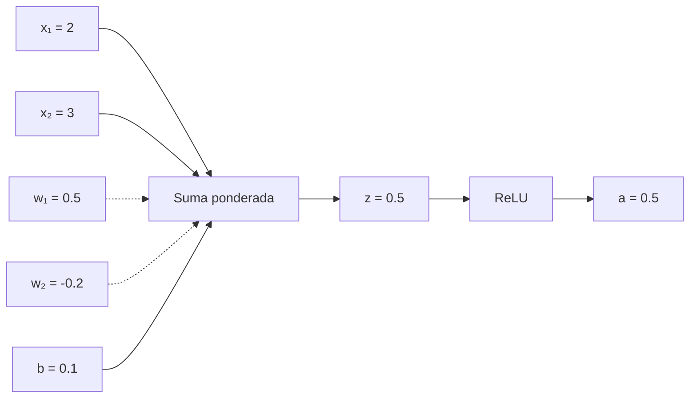

# 2. Desde cero: la neurona artificial

## De una entrada a una salida

La neurona artificial más simple combina una entrada con un peso y un sesgo:

\[
y=wx+b.
\]

`x` es la entrada, `w` el peso, `b` el sesgo y `y` la salida. El peso indica cuánto influye la entrada; el sesgo desplaza el resultado incluso cuando la entrada vale cero.

Con varias entradas:

\[
z=\sum_{i=1}^{n}w_i x_i+b,\qquad a=f(z).
\]

`z` es la suma ponderada y `f` una función de activación. Por ejemplo, ReLU es `f(z)=max(0,z)`. La activación permite combinar transformaciones de manera no lineal.

## Ejemplo resuelto

Con `x₁=2`, `x₂=3`, `w₁=0.5`, `w₂=-0.2` y `b=0.1`:

\[
z=(2\times0.5)+(3\times-0.2)+0.1=1-0.6+0.1=0.5.
\]

Con ReLU, `a=max(0,0.5)=0.5`. La neurona recibe dos señales, pondera cada una, suma el sesgo y conserva el valor positivo.



## Red multicapa

Una capa reúne neuronas. Las salidas de una capa alimentan la siguiente:


La analogía de una báscula ayuda a visualizar los pesos, pero no debe ocultar que en una red real se calculan vectores y matrices en paralelo.

## Implementación mínima

```python
def neurona(entradas, pesos, sesgo):
    z = sum(x * w for x, w in zip(entradas, pesos)) + sesgo
    return max(0.0, z)  # ReLU

print(neurona([2, 3], [0.5, -0.2], 0.1))  # 0.5
```

## Confusiones frecuentes

Una neurona no es una neurona biológica en miniatura; es una función matemática. Un peso no es una regla escrita como “si ocurre X, responde Y”. Y la activación no representa necesariamente una palabra o una idea comprensible.

## Resumen y práctica

Aprendimos entradas, pesos, sesgo, suma ponderada, activación y composición en capas. Pregúntate qué ocurre si el peso negativo cambia a `0.2`. Actividad: modifica los valores del programa y predice el resultado antes de ejecutarlo.

[Siguiente: parámetros →](03-parametros.md)
