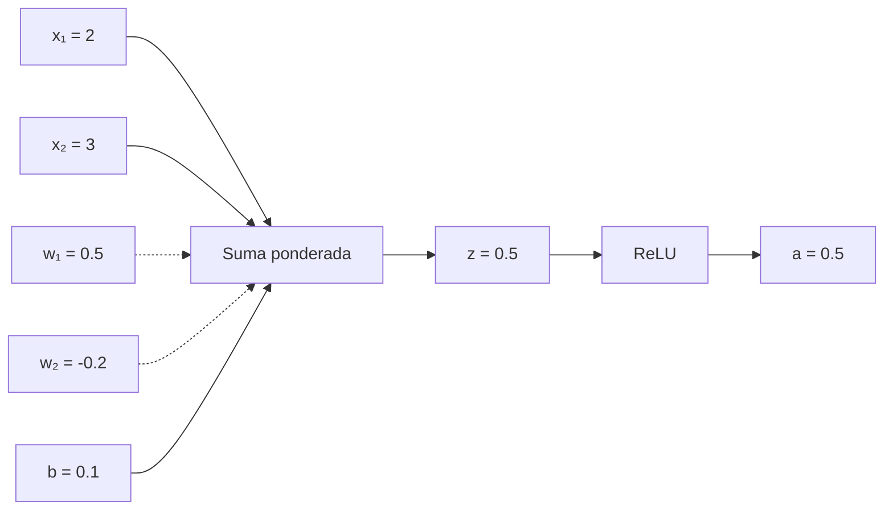
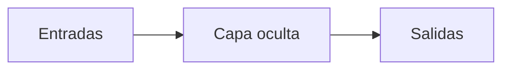

# 2. Las matemáticas mínimas para entender una IA

Antes de multiplicar entradas por pesos, conviene leer una fórmula como una instrucción. En $y = 2x + 1$, $x$ es una variable, 2 y 1 son constantes, y la función transforma cualquier entrada en una salida. Sustituir $x=3$ produce $y=7$.

Una variable puede cambiar; una constante se mantiene en el ejemplo. Una suma como $2+3+4$ puede escribirse como $\sum_{i=1}^{3} i$; una potencia repite multiplicaciones: $2^3=8$. Una fracción compara cantidades. Una probabilidad está entre 0 y 1, y las probabilidades de resultados excluyentes suman 1.

Un vector es una lista ordenada, por ejemplo $\mathbf{x}=[2,3]$. Una matriz es una tabla: $W$ de tamaño $2\times 3$ tiene dos filas y tres columnas. La derivada responde “¿qué tan rápido cambia la salida?”; el gradiente reúne derivadas para orientar una actualización. Estas ideas reaparecen en los capítulos 3–7.

## Práctica matemática

Calcula $y = 3x - 2$ para $x=0,1,2$. Después representa las calificaciones $[8,9,7]$ como un vector y explica qué información se perdería si se cambiara el orden.

## Aplicación: una neurona

## De una entrada a una salida

La neurona artificial más simple combina una entrada con un peso y un sesgo:

$$
y = wx + b.
$$

`x` es la entrada, `w` el peso, `b` el sesgo y `y` la salida. El peso indica cuánto influye la entrada; el sesgo desplaza el resultado incluso cuando la entrada vale cero.

Con varias entradas:

$$
z = \sum_{i=1}^{n} w_i x_i + b,
\qquad a = f(z).
$$

`z` es la suma ponderada y `f` una función de activación. Por ejemplo, ReLU es $f(z) = \max(0,z)$. La activación permite combinar transformaciones de manera no lineal.

## Ejemplo resuelto

Con $x_1 = 2$, $x_2 = 3$, $w_1 = 0.5$, $w_2 = -0.2$ y $b = 0.1$:

$$
\begin{aligned}
z &= (2 \times 0.5) + (3 \times -0.2) + 0.1 \\
  &= 1 - 0.6 + 0.1 = 0.5.
\end{aligned}
$$

Con ReLU, $a = \max(0,0.5) = 0.5$. La neurona recibe dos señales, pondera cada una, suma el sesgo y conserva el valor positivo.



## Red multicapa

Una capa reúne neuronas. Las salidas de una capa alimentan la siguiente:



La analogía de una báscula ayuda a visualizar los pesos, pero no debe ocultar que en una red real se calculan vectores y matrices en paralelo.

## Implementación mínima

```python
def neurona(entradas, pesos, sesgo):
    z = sum(x * w for x, w in zip(entradas, pesos)) + sesgo
    return max(0.0, z)  # ReLU

print(neurona([2, 3], [0.5, -0.2], 0.1))  # 0.5
```

## Confusiones frecuentes

Una neurona no es una neurona biológica en miniatura; es una función matemática. Un peso no es una regla escrita como “si ocurre X, responde Y”. Y la activación no representa necesariamente una palabra o una idea comprensible.

## Resumen y práctica

Aprendimos entradas, pesos, sesgo, suma ponderada, activación y composición en capas. Pregúntate qué ocurre si el peso negativo cambia a `0.2`. Actividad: modifica los valores del programa y predice el resultado antes de ejecutarlo.

[Siguiente: parámetros →](03-parametros.md)
