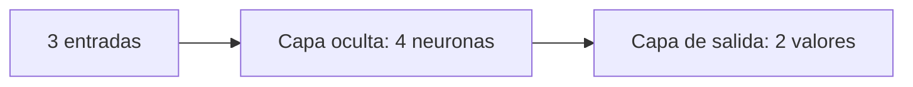
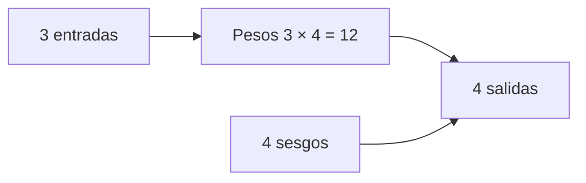

# 4. ¿Qué es una red neuronal?

Una red conecta muchas neuronas en capas. La capa de entrada recibe características, las capas ocultas transforman representaciones y la salida produce una predicción. La propagación hacia adelante aplica esas transformaciones en orden.



En una red $3\rightarrow4\rightarrow2$, la primera capa convierte un vector de tres componentes en uno de cuatro; la segunda convierte ese vector en dos salidas. Cada conexión tiene un peso y cada unidad de salida puede tener un sesgo. Las activaciones evitan que la composición sea solo una operación lineal.

El resto de este capítulo cuenta esos valores y muestra por qué las dimensiones de las matrices deben coincidir.

## Neuronas y capas densas

Una neurona con tres entradas tiene tres pesos y un sesgo: $3 + 1 = 4$. Una capa densa con $n_{\text{entrada}}$ entradas y $n_{\text{salida}}$ neuronas tiene una matriz de pesos de tamaño $n_{\text{entrada}} \times n_{\text{salida}}$ y un sesgo por neurona:

$$
P = (n_{\text{entrada}} \times n_{\text{salida}}) + n_{\text{salida}}.
$$

Para 3 entradas y 4 neuronas: $(3 \times 4) + 4 = 16$. La matriz contiene 12 pesos; el vector de sesgos contiene 4 valores.



En una red $3 \rightarrow 4 \rightarrow 2$: primera capa $16$; segunda $(4 \times 2) + 2 = 10$; total $26$.

## Tensores y Transformers

Un tensor de forma $3 \times 4 \times 5$ tiene $3 \times 4 \times 5 = 60$ elementos. En arquitecturas de lenguaje, aparecen embeddings, proyecciones de query/key/value, capas feed-forward, normalizaciones y, según el diseño, vocabularios y pesos compartidos.

Un embedding de vocabulario $V$ y dimensión $d$ aporta $V \times d$. Una proyección lineal de entrada $d_{\text{in}}$ a $d_{\text{out}}$ aporta $d_{\text{in}} \times d_{\text{out}} + d_{\text{out}}$. Una normalización suele aportar dos vectores de tamaño $d$, aunque el detalle depende de la arquitectura.

El total real depende de dimensiones, capas, si hay sesgos, pesos compartidos y componentes opcionales. `1B`, `7B` y `70B` suelen ser cifras redondeadas, no identificadores exactos.

## No confundir escalas

Cantidad de parámetros no es cantidad de neuronas. Tampoco es cantidad de tokens de entrenamiento ni de respuestas guardadas. Dos modelos con igual número de parámetros pueden diferir en datos, arquitectura, entrenamiento y calidad.

## Ejercicio reproducible

```python
def parametros_densa(entradas, salidas):
    return entradas * salidas + salidas

print(parametros_densa(3, 4))  # 16
print(parametros_densa(4, 2))  # 10
```

## Resumen y práctica

Cuenta pesos por conexiones y sesgos por unidad de salida. Preguntas: ¿cuántos elementos hay en una matriz $3 \times 4$? ¿qué cambia al compartir pesos? ¿por qué el nombre “7B” no basta para calcular memoria exacta?

[Siguiente: entrenamiento →](05-entrenamiento.md)
