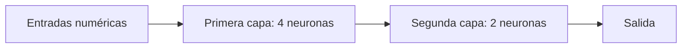

# 4. ¿Qué es una red neuronal?

## Del interruptor a una orquesta de operaciones

Una sola neurona transforma unas pocas entradas. ¿Y si necesitamos reconocer un patrón más complicado, como distinguir señales de tráfico? Podemos conectar muchas transformaciones. Una **red neuronal** es una estructura de funciones matemáticas organizadas para que las salidas de unas alimenten a otras. No hay una neurona encargada de cada palabra o idea.

### Capas y flechas

En una **capa densa** cada neurona recibe todas las salidas de la capa anterior. Con 3 entradas y 4 neuronas necesitamos 12 pesos, uno por cada par entrada–neurona, y 4 sesgos, uno por neurona. Esto da 16 parámetros. Una segunda capa de 4 entradas y 2 neuronas añade $4\times2+2=10$. **Total: 26 parámetros**, suponiendo pesos y sesgos no compartidos.

### Calcula una capa, de verdad

Tomemos la entrada $\mathbf{x}=[1,2]$. La letra en negrita indica un vector: una lista ordenada. La capa tiene dos neuronas:

- Neurona A: pesos $[0.5,1]$ y sesgo $0$.
- Neurona B: pesos $[-1,0.5]$ y sesgo $1$.

Con la notación $\mathbf{z}=W\mathbf{x}+\mathbf{b}$ escribimos:

$$
W=\begin{bmatrix}0.5&1\\-1&0.5\end{bmatrix},\qquad
\mathbf b=\begin{bmatrix}0\\1\end{bmatrix}.
$$

Cada fila de $W$ contiene los pesos de una neurona. Los cálculos son:

$$
\begin{aligned}
z_A&=0.5(1)+1(2)+0=2.5,\\
z_B&=-1(1)+0.5(2)+1=1.
\end{aligned}
$$

Por tanto, $\mathbf z=[2.5,1]$. Si aplicamos ReLU, ninguno cambia porque los dos son positivos. La siguiente capa recibiría estos dos valores, no necesariamente los números originales.

### ¿Qué significa una dimensión?

La matriz $W$ tiene forma $2\times2$: dos filas y dos columnas. El vector de entrada tiene dos componentes. Si intentamos multiplicar una matriz con tres columnas por un vector de dos componentes, las dimensiones no coinciden. La multiplicación de matrices requiere que el número de columnas de la primera matriz coincida con el número de filas de la segunda.

Para una capa densa que conecta $m$ entradas con $n$ salidas:

$$P=m n+n=n(m+1).$$

El primer término cuenta pesos y el segundo, sesgos. Hay capas que no tienen sesgos o comparten pesos; por eso esta fórmula no sirve sin ajustes para cualquier arquitectura.

### ¿Cómo llega a aprender patrones?

Primero, una red recibe un dato y lo transforma hacia adelante: **propagación hacia adelante**. Después, durante el entrenamiento, se compara la salida con un objetivo y se calculan ajustes. Son dos fases diferentes: calcular una predicción no es necesariamente aprender.

**Compruébalo:** ejecuta `ejemplos/contar_parametros.py` si ya existe en el repositorio. Verifica que las dos capas 3→4 y 4→2 sumen 26.

**Ejercicio.** Una capa recibe 5 entradas y devuelve 3 salidas, con sesgo por neurona. ¿Cuántos parámetros? **Solución:** $5\times3+3=18$.

**Confusión común:** «más capas» y «más parámetros» no son sinónimos. Una capa pequeña puede contener menos pesos que otra sola capa enorme.

**Enlace:** [continuar: qué son los parámetros](05-entrenamiento.md).
