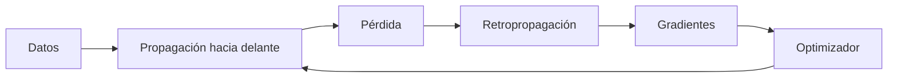

# 5. ¿Qué son realmente los parámetros?

Imagina una máquina que calcula descuentos. Sus pesos determinan cuánto importa el precio y el porcentaje; el sesgo desplaza el resultado. El entrenamiento modifica esos números, pero una activación intermedia no es un parámetro permanente.

Los parámetros entrenables se actualizan mediante gradientes. Un parámetro congelado permanece fijo durante una etapa; un hiperparámetro, como la tasa de aprendizaje, configura el proceso. El estado del optimizador ayuda a continuar el entrenamiento, pero no es necesariamente parte de la respuesta del modelo.

## El aprendizaje como ajuste

Entrenar es repetir predicción, comparación y ajuste. Para una predicción $\hat{y}$ y objetivo $y$, una pérdida sencilla es:

$$
L = (\hat{y} - y)^2.
$$

El descenso de gradiente actualiza un parámetro:

$$
w_{\text{nuevo}} = w_{\text{anterior}}
  - \eta \frac{\partial L}{\partial w}.
$$

donde $\eta$ es la tasa de aprendizaje y la derivada indica cómo cambia el error al cambiar $w$.

## Ejemplo completo

Considera $\hat{y} = wx$, objetivo $y = 4$, ejemplo $x = 2$, $w = 1$ y $\eta = 0.1$.

1. Predicción: $\hat{y} = 1 \times 2 = 2$.
2. Error: $\hat{y} - y = -2$.
3. Pérdida: $L = (-2)^2 = 4$.
4. Derivada: como $L = (wx - y)^2$:

   $$
   \begin{aligned}
   \frac{\partial L}{\partial w}
   &= 2(wx-y)x \\
   &= 2(-2)(2) = -8.
   \end{aligned}
   $$
5. Actualización: $w = 1 - 0.1(-8) = 1.8$.

Segunda iteración: $\hat{y} = 1.8 \times 2 = 3.6$, $L = (3.6 - 4)^2 = 0.16$; el error disminuyó. El ajuste no “comprende” el ejemplo: mueve un número en la dirección que reduce la función definida.

## Retropropagación

En una red con muchas capas, la regla de la cadena transmite cómo cada parámetro contribuyó a la pérdida. El gradiente viaja desde la salida hacia capas anteriores. La retropropagación no es un segundo tipo de aprendizaje; es un método eficiente para calcular derivadas.

## Datos y generalización

Una época recorre el conjunto de entrenamiento; un lote es una parte del conjunto. Validación y prueba ayudan a detectar sobreajuste: memorizar patrones particulares sin generalizar. El subajuste ocurre cuando el modelo o entrenamiento no capturan suficiente estructura.

## Confusiones frecuentes

Reducir pérdida no garantiza verdad, justicia o utilidad. La función de pérdida es una medida definida por el diseño. Chatear con un modelo normalmente no modifica sus parámetros; la conversación solo cambia el contexto de inferencia.

## Resumen y práctica

El entrenamiento ajusta parámetros mediante gradientes. Preguntas: ¿qué representa $\eta$? ¿por qué se resta el gradiente? ¿cómo distinguir error de entrenamiento y generalización? Ejecuta `ejemplos/descenso_gradiente.py` y observa dos iteraciones.

[Siguiente: preentrenamiento y ajuste fino →](06-preentrenamiento.md)
