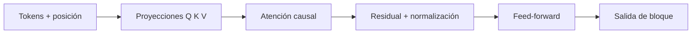

# 9. Transformers y atención

La arquitectura Transformer procesa secuencias con atención y capas feed-forward. En self-attention cada posición calcula qué otras posiciones son relevantes.

$$
\operatorname{Attention}(Q, K, V)
 = \operatorname{softmax}\left(\frac{QK^{\mathsf{T}}}{\sqrt{d_k}}\right)V.
$$

$Q$ (query) pregunta, $K$ (key) describe qué ofrece cada posición, $V$ (value) contiene la información agregada y $d_k$ es la dimensión de las claves. $QK^{\mathsf{T}}$ produce compatibilidades; dividir estabiliza escalas; softmax convierte cada fila en pesos que suman 1.

Ejemplo simplificado: si una consulta produce puntuaciones $[2, 1]$, $\operatorname{softmax}$ asigna aproximadamente $[0.73, 0.27]$; la salida pondera 73 % del primer valor y 27 % del segundo.

La atención causal impide usar tokens futuros al predecir el siguiente. La atención multicabeza calcula varios patrones; las conexiones residuales y la normalización ayudan al entrenamiento. La posición se incorpora mediante representaciones posicionales.

Atención matemática no es atención humana ni prueba de conciencia. Preguntas: ¿por qué no se puede mirar el futuro?, ¿qué dimensión escala la fórmula?, ¿qué significa que los pesos sumen 1?

[Siguiente →](10-llm.md)
