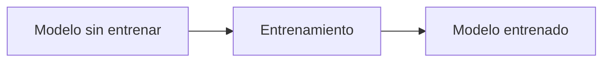

# 10. ¿Qué es un modelo sin entrenar?

Una arquitectura puede estar definida antes de aprender patrones útiles. Sus pesos tienen valores iniciales, quizá aleatorios o calculados con una estrategia de inicialización, pero la red todavía no ha optimizado su objetivo. Una demostración consiste en ejecutar `ejemplos/neurona.py` con pesos arbitrarios y comparar sus predicciones antes de ajustar nada.

## Modelo y arquitectura

La arquitectura describe capas y operaciones; los pesos son el estado numérico. La función de pérdida define qué significa equivocarse. Tener una arquitectura compleja no equivale a tener conocimiento.

## LLM como ampliación

LLM significa *Large Language Model*: modelo de lenguaje grande. No hay un umbral universal que separe “grande” de “pequeño”. Importan parámetros, arquitectura, datos, contexto, calidad de entrenamiento y eficiencia.

Como escala hipotética, 0.5B, 1B, 3B, 7B y 70B indican aproximadamente cientos de millones o miles de millones de parámetros. Más parámetros pueden aumentar capacidad, pero no garantizan mejores datos, seguridad, razonamiento o factualidad.

Un LLM contiene capas que transforman IDs y representaciones; no contiene una biblioteca literal de respuestas. La conducta surge de la interacción entre pesos, entrada, decodificación y, si existe, herramientas externas.

**Actividad:** compara dos modelos hipotéticos con igual número de parámetros pero datos y contexto distintos. ¿Por qué no puedes concluir cuál responde mejor solo por el tamaño?

[Siguiente →](11-inferencia.md)
