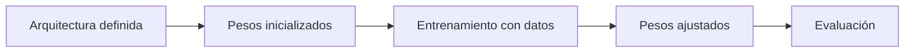

# 10. ¿Qué es un modelo sin entrenar?

## Una máquina recién construida todavía no sabe hacer su trabajo

Puedes construir un instrumento musical perfecto, pero eso no significa que interprete una melodía por sí solo. Algo parecido ocurre con una red neuronal: definir su arquitectura no implica que ya haya aprendido una tarea.

### Arquitectura y pesos son cosas distintas

La **arquitectura** especifica cuántas capas hay, qué operaciones realizan y cómo se conectan. Los **pesos** son los números concretos utilizados en esas operaciones. Una arquitectura puede existir con pesos inicializados sin haber recibido datos de entrenamiento.

Imagina $\hat y=wx$ y el objetivo $y=2x$. Si $w=0$, para $x=3$ predice $0$ y la respuesta correcta sería $6$. Si $w=0.5$, predice $1.5$. Ninguno de esos números demuestra que haya aprendido: simplemente indican su punto de partida.

### ¿Por qué no empezar siempre con todos los pesos en cero?

En una regresión lineal elemental puede hacerse. En redes con muchas neuronas simétricas, inicializar pesos idénticos puede provocar que varias aprendan exactamente el mismo patrón. Existen inicializaciones que utilizan escalas dependientes de las dimensiones para mantener las señales en rangos convenientes.

### ¿Qué necesita para empezar a aprender?

Una tarea, ejemplos, una función de pérdida, un método para calcular gradientes y un optimizador. Durante el entrenamiento se ajustan parámetros. Durante una ejecución normal de inferencia, los pesos se mantienen.

### ¿Podemos usar un modelo sin entrenar?

Sí: para probar dimensiones, ejecutar cálculos o comprobar que un programa funciona. Pero sus predicciones carecen, en general, de aprendizaje útil para el problema. Un generador de texto sin entrenamiento puede producir resultados arbitrarios porque no ha ajustado las regularidades del lenguaje.

**Ejercicio resuelto.** Con $w=0.5$, $x=4$ y objetivo $y=8$: $\hat y=2$ y $L=(2-8)^2=36$. No basta con decir «el modelo se equivocó»: debemos expresar cuánto y cómo podríamos corregirlo.

**Confusión común:** «sin entrenar» no significa «sin parámetros». Puede tener millones de parámetros inicializados y aun así carecer de entrenamiento útil.

**Siguiente:** [qué ocurre a mitad del entrenamiento](11-inferencia.md).
