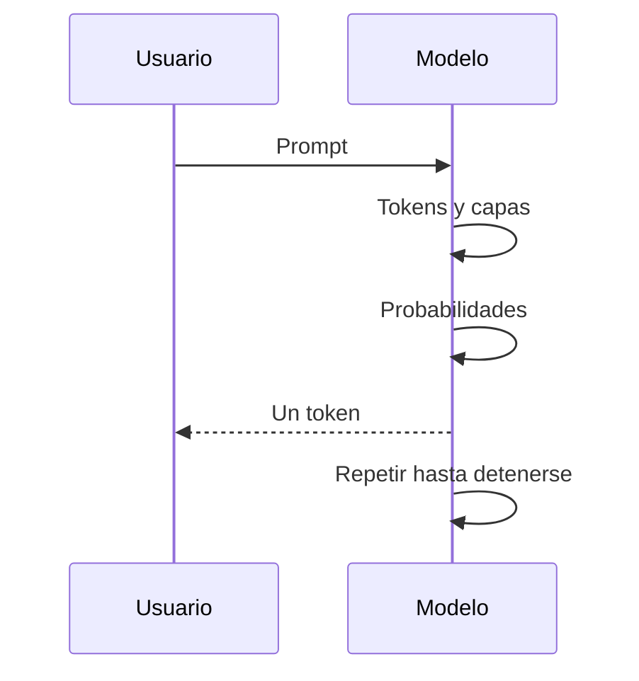

# 11. ¿Qué es un modelo parcialmente entrenado?

“Parcialmente entrenado” describe el estado de un proceso, no una arquitectura universal. Un checkpoint puede guardar pesos, época, contador de pasos y estado del optimizador para continuar. La evaluación intermedia permite observar aprendizaje y sobreajuste, pero un checkpoint parcial no es automáticamente útil.

El ejemplo `ejemplos/entrenar_modelo.py` guarda una red pequeña, la carga y comprueba que la predicción se conserva. En un sistema real también se documentan versiones de datos, hiperparámetros y métricas.

## Inferencia de un modelo ya entrenado

El flujo general es: prompt → tokenización → embeddings → capas → logits → probabilidades → selección → nuevo token → repetición.

Los logits $z_i$ se convierten con softmax:

$$
P_i = \frac{e^{z_i}}{\sum_j e^{z_j}}.
$$

Con logits $[2, 1]$, las probabilidades son aproximadamente $[0.73, 0.27]$. La temperatura $T$ modifica $z_i / T$: una temperatura menor concentra la distribución; una mayor la aplana. Greedy elige el máximo; top-$k$ conserva $k$ candidatos; top-$p$ conserva el conjunto cuya masa acumulada alcanza $p$.

La variación puede provenir del muestreo, temperatura, contexto o estado del sistema. Predicción no es recuperación literal de respuestas almacenadas.

**Práctica:** ejecuta `ejemplos/probabilidades.py`. Preguntas: ¿qué ocurre con $T = 0.5$?, ¿por qué un token probable puede ser falso?, ¿qué señal detiene la generación?

[Siguiente →](12-memoria-y-contexto.md)
