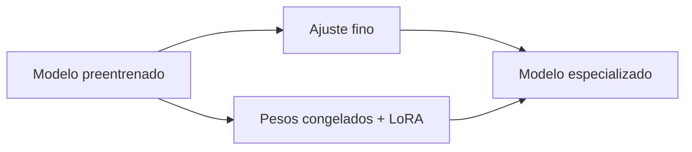

# 13. ¿Qué es fine-tuning y qué es LoRA?

El ajuste fino adapta un modelo preentrenado a una tarea o estilo. Puede actualizar todos los pesos, solo algunas capas o adaptadores. PEFT agrupa estrategias que reducen los parámetros entrenables; LoRA aprende matrices de baja dimensión que se combinan con pesos congelados y QLoRA añade cuantización al flujo.

LoRA no es siempre superior: ahorra memoria y facilita varios adaptadores, pero puede limitarse si la tarea exige cambios amplios. Hay que evaluar sobre datos no vistos y vigilar sobreajuste. Un ejemplo hipotético: si una capa tiene 1,000,000 de pesos y un adaptador entrena 20,000, solo esos 20,000 se actualizan en esa etapa.

## Precisión numérica y cuantización

Bits codifican valores. FP32 usa 32 bits, FP16 16, BF16 conserva más rango con menos precisión, INT8 usa enteros de 8 bits y Q4 suele referirse a pesos de aproximadamente 4 bits con escalas auxiliares.

El tamaño teórico de pesos es:

$$
\text{bytes}
 = \frac{\text{parámetros} \times \text{bits por parámetro}}{8}.
$$

Para 1,000 millones a 16 bits:

$$
\begin{aligned}
1{,}000{,}000{,}000 \times \frac{16}{8}
  &= 2{,}000{,}000{,}000\ \text{bytes}.
\end{aligned}
$$

es decir, 2 GB decimales o aproximadamente 1.86 GiB antes de sobrecargas.

En la práctica se suman escalas, metadatos, activaciones, buffers y caché KV. Entrenar requiere gradientes y estados del optimizador; inferir requiere pesos, activaciones y caché. Cuantizar reduce memoria, pero puede degradar algunas salidas y el efecto depende del método y datos.

Preguntas: ¿por qué GB y GiB difieren?, ¿qué memoria se reutiliza entre tokens?, ¿por qué Q4 no significa exactamente cuatro bits para cada byte del archivo?

[Siguiente →](14-ejecucion-de-modelos.md)
