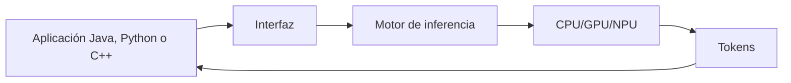

# 14. ¿Cómo se ejecuta un modelo en una computadora?

CPU, GPU y NPU ejecutan operaciones numéricas; las GPU suelen paralelizar matrices. Un motor carga pesos, prepara el contexto, ejecuta el prompt y genera tokens. La latencia del primer token y los tokens por segundo son medidas distintas.

La ejecución puede ser local o remota. Una interfaz no concede permisos por sí sola: el sistema que conecta herramientas debe autenticar, validar entradas y limitar acciones.

**Actividad:** calcula por qué una generación de 20 tokens no implica 20 llamadas de red en una aplicación que mantiene una sesión local.

[Siguiente →](15-razonamiento.md)
