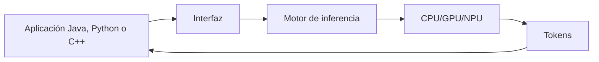

# 14. ¿Cómo entrenar un modelo propio, paso a paso?

Un proyecto pequeño sigue esta secuencia: definir problema; reunir datos y permisos; separar entrenamiento, validación y prueba; escoger arquitectura, pérdida y optimizador; predecir; calcular errores y gradientes; actualizar; evaluar; guardar pesos; cargarlos; probar ejemplos nuevos y documentar limitaciones. `ejemplos/entrenar_modelo.py` implementa una versión lineal con biblioteca estándar y checkpoint JSON.

Construir desde cero es útil para aprender. Inicializar una arquitectura mayor exige más datos y hardware. Partir de un modelo preentrenado puede ahorrar entrenamiento, pero introduce licencias, sesgos y requisitos de evaluación. Este modelo educativo no es un LLM.

## Ejecución después del entrenamiento

CPU, GPU y NPU ejecutan operaciones numéricas; las GPU suelen paralelizar matrices. Un motor carga pesos, prepara el contexto, ejecuta el prompt y genera tokens. La latencia del primer token y los tokens por segundo son medidas distintas.

La ejecución puede ser local o remota. Una interfaz no concede permisos por sí sola: el sistema que conecta herramientas debe autenticar, validar entradas y limitar acciones.

**Actividad:** calcula por qué una generación de 20 tokens no implica 20 llamadas de red en una aplicación que mantiene una sesión local.

[Siguiente →](15-razonamiento.md)
