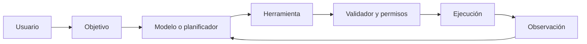

# 17. Tokens, embeddings y representaciones numéricas

El recorrido es texto → tokens → IDs → vectores. Un token puede ser palabra, fragmento, carácter o byte; un embedding asigna coordenadas aprendidas. La similitud de dos vectores puede medirse con un producto escalar o coseno, pero ningún eje universal significa una idea.

## Agentes como aplicación



Un agente interpreta el objetivo, elige una herramienta, propone una acción, valida argumentos, ejecuta y observa el resultado. Las acciones sensibles deben requerir confirmación. Una salida estructurada puede tener esta forma:

```json
{"herramienta":"pronostico","argumentos":{"ciudad":"Villahermosa"},"requiere_confirmacion":false}
```

El JSON debe validarse contra un esquema antes de usarlo. La memoria puede guardar estado, pero debe respetar permisos y minimización de datos.

Ejemplo: “Consulta el pronóstico y prepara un resumen”. El agente necesita una fuente actualizada; un LLM aislado no conoce el clima presente. Para una tarea de varios pasos debe registrar resultados parciales y detenerse ante ambigüedad.

**Práctica:** ejecuta `ejemplos/agente_simulado.py`. Preguntas: ¿qué acción necesita confirmación?, ¿cómo detectar un argumento inválido?, ¿qué ocurre si la herramienta falla?

[Siguiente →](18-experimentos.md)
