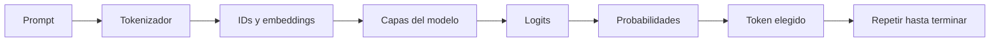

# 20. Inferencia: cómo genera una respuesta un modelo

## ¿Cómo puede aparecer una frase nueva en pantalla?

Piensa en escribir una historia palabra por palabra. Para cada paso, un modelo de lenguaje estima probabilidades de continuaciones y selecciona una unidad de texto. La respuesta completa se construye mediante muchas decisiones sucesivas; no tiene que existir como una frase almacenada antes de empezar.

### El recorrido completo

El **prompt** es la entrada, incluyendo instrucciones y contexto. El tokenizador la convierte en IDs. Las capas calculan representaciones y producen **logits**: puntuaciones numéricas antes de transformarlas en probabilidades.

### De puntuaciones a probabilidades: softmax

Si los logits hipotéticos para tres tokens son $[2,1,0]$, aplicamos:

$$P_i=\frac{e^{z_i}}{\sum_j e^{z_j}},$$

con $z_i$ igual al logit del token $i$; $e$ es la base de los logaritmos naturales. Los valores aproximados son $e^2=7.389$, $e^1=2.718$ y $e^0=1$. La suma es $11.107$. Así obtenemos probabilidades aproximadas $[0.665,0.245,0.090]$.

### ¿Cómo se elige el token?

**Greedy decoding** elige el token con probabilidad más alta. **Temperatura** modifica la distribución: valores menores suelen concentrar probabilidades, y valores mayores suelen repartirlas más. **Top-k** restringe la selección a los $k$ candidatos mejor puntuados; **top-p** a un conjunto cuya probabilidad acumulada alcanza un umbral. No todas las aplicaciones usan estos procedimientos ni las mismas configuraciones.

### Prefill y generación

En modelos autoregresivos, el procesamiento inicial del prompt se suele llamar **prefill**; después se ejecuta la **decodificación** paso a paso. El tiempo hasta el primer token y los tokens generados por segundo describen aspectos diferentes del rendimiento.

### ¿Cuándo termina?

Puede detenerse al generar un token especial de finalización o por un límite configurado de longitud. Si el límite es demasiado corto, una respuesta puede quedar incompleta.

**Práctica:** ejecuta `ejemplos/probabilidades.py` y observa cómo cambia la distribución al variar la temperatura. **Ejercicio:** con tres probabilidades iguales, ¿qué selecciona greedy si hay empate? Depende de la regla de desempate implementada; no hay una palabra universalmente correcta.

**Error frecuente:** la probabilidad de una continuación no garantiza que el texto describa un hecho real.

**Siguiente:** [cómo se ejecuta un modelo](21-ejecucion-y-memoria.md).
