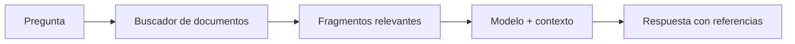

# 23. Memoria, contexto, conocimiento y razonamiento

## ¿Por qué una IA puede «recordar» tu nombre sin haber aprendido nuevos pesos?

Si una aplicación guarda «Mi nombre es Laura» en una base de datos, puede recuperar la frase en una conversación posterior y agregarla al prompt. El modelo responde «Laura» porque la información fue proporcionada como contexto. **Eso no significa que haya actualizado sus parámetros**.

### Cuatro cosas distintas

| Concepto | Qué contiene | Qué cambia |
|---|---|---|
| Pesos del modelo | Números aprendidos | Normalmente solo con entrenamiento |
| Contexto | Tokens de entrada actuales | Cambia en cada consulta |
| Historial externo | Mensajes guardados | Cambia al guardar información |
| Documentos recuperados | Datos consultados para responder | Cambian según búsqueda y fuentes |

### ¿Qué es RAG?

RAG significa *generación aumentada por recuperación*. Una aplicación recibe una pregunta, busca documentos relevantes, selecciona fragmentos y los añade al contexto del modelo. El modelo puede entonces utilizar esos fragmentos al redactar. Esto permite trabajar con información que no tiene que estar incluida en los pesos.

Si la búsqueda recupera documentos equivocados, la respuesta puede ser mala. Por eso conviene mostrar fuentes, comprobar fechas y evitar que el modelo trate instrucciones maliciosas contenidas en documentos como órdenes confiables.

### ¿Qué significa razonar?

En la práctica evaluamos si un sistema puede resolver problemas con pasos coherentes, comparar opciones o corregir errores. Esto describe **capacidades observables**; no implica demostrar conciencia ni pensamiento idéntico al humano. Los modelos de lenguaje pueden producir explicaciones convincentes y aun así cometer errores de lógica o aritmética.

### ¿Por qué alucinan?

Un sistema generativo puede producir una continuación lingüísticamente plausible que no corresponde con hechos verificables. No siempre sabe cuándo desconoce una respuesta. Mejoras posibles incluyen búsqueda confiable, cálculo externo, verificación y límites sobre tareas sensibles.

**Ejercicio.** Un chatbot responde hoy el horario de una biblioteca usando únicamente sus pesos de hace años. ¿Qué le falta? **Una fuente actualizada** si necesita confirmar el horario vigente.

**Siguiente:** [modelo, aplicación y agente](24-sistemas-de-ia.md).
