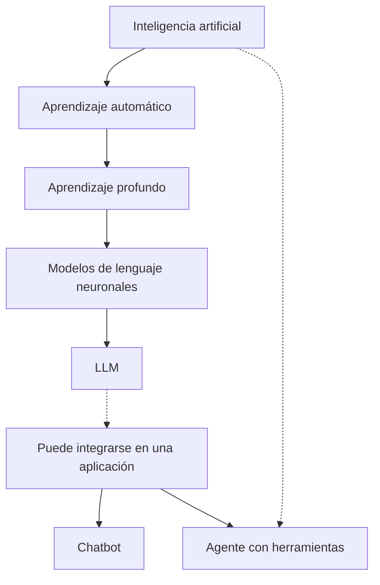

# 24. IA, modelos, LLM, chatbots, asistentes y agentes

## Un motor no es un automóvil completo

El motor transforma energía en movimiento, pero el automóvil incluye dirección, frenos, sensores y controles. Algo semejante sucede con un **modelo de IA** y una **aplicación**: el modelo produce predicciones, mientras que el sistema completo organiza entradas, permisos, herramientas, interfaz y resultados.

### Conceptos sin confusión

- **Inteligencia artificial:** campo amplio que desarrolla métodos y sistemas capaces de tareas como predicción, percepción, planificación o generación.
- **Modelo de IA:** componente matemático o computacional ajustado para realizar tareas; puede ser un clasificador, una red de visión o un modelo generativo.
- **Modelo de lenguaje:** aprende regularidades de secuencias lingüísticas y permite calcular o generar texto, según su diseño.
- **LLM:** modelo de lenguaje de gran escala; un tipo particular de modelo de IA.
- **Chatbot:** aplicación que interactúa mediante mensajes. Puede utilizar reglas, un LLM o combinar ambos.
- **Asistente:** aplicación orientada a apoyar tareas de un usuario; puede tener o no herramientas.
- **Agente de IA:** sistema que, dentro de objetivos y límites, selecciona acciones, utiliza herramientas y observa resultados.
- **Sistema multiagente:** coordinación de múltiples agentes o componentes agentes.

### Un solo pedido, diferentes capacidades

Usuario: «Dime el clima de mañana y prepara un resumen».

Un **modelo de lenguaje aislado** puede interpretar la solicitud y producir texto, pero no consulta automáticamente datos meteorológicos recientes. Un **chatbot** podría limitarse a responder con una explicación. Un **agente** con herramienta de consulta, validación y permisos puede obtener el pronóstico, evaluar la respuesta y redactar el resumen, siempre que se le haya dado ese acceso.

### ¿Todos los agentes usan LLM?

No. Un agente de videojuegos puede seguir reglas, búsqueda o aprendizaje por refuerzo sin un gran modelo de lenguaje. Asimismo, integrar un LLM en un chat no convierte automáticamente la aplicación en un agente.

### Diagrama de relaciones

El diagrama muestra relaciones habituales, no una jerarquía estricta: también existen modelos de lenguaje no neuronales, y un agente puede usar otros métodos.

**Ejercicio:** clasifica un filtro de spam, un buscador tradicional, una aplicación de chat con LLM y un robot con planificación. Explica qué parte es modelo, qué parte es sistema y qué herramientas utiliza cada uno.

**Siguiente:** [ciclo completo de un agente](25-agentes.md).
