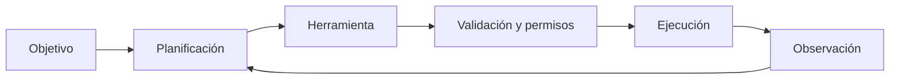

# 25. ¿Cómo funciona un agente de IA?

## Del objetivo a la observación

Un agente recibe un objetivo, propone un plan, selecciona una herramienta, valida argumentos, ejecuta dentro de permisos y observa el resultado. El ciclo puede repetirse, pero una acción sensible debe detenerse para pedir confirmación.

El agente simulado de `ejemplos/agente_simulado.py` solo consulta un pronóstico ficticio. Rechaza herramientas desconocidas y ciudades vacías: la validación es una barrera, no una garantía absoluta.

## Ejemplo

Para “consulta el clima de Villahermosa y prepara un resumen”, el modelo propone una llamada; el validador comprueba que la herramienta y la ciudad están permitidas; la herramienta devuelve datos; el modelo redacta el resumen. No se debe presentar un dato inventado como actual.

## Autoevaluación

¿Qué cambia si la herramienta falla? El agente debe conservar el error, informar la limitación y no fingir éxito. ¿Qué requiere confirmación? Enviar dinero, borrar datos o modificar una cuenta, aunque el modelo haya producido una instrucción válida.
