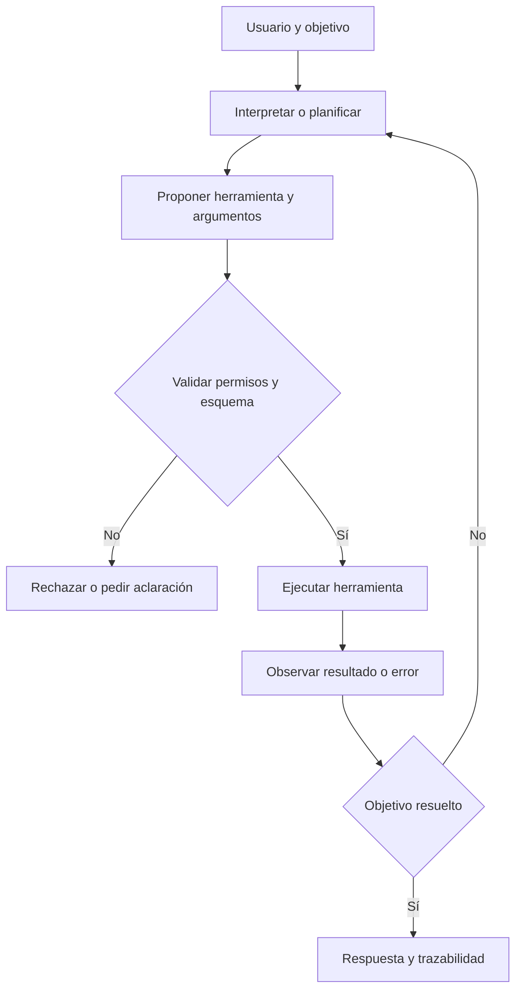

# 25. Cómo funciona un agente de IA con herramientas

## De responder preguntas a completar tareas

Imagina que pides: «Comprueba si mañana lloverá y prepara una lista de cosas que debo llevar». Un modelo de lenguaje puede redactar una lista genérica. Un **agente** podría consultar una herramienta meteorológica autorizada, leer el resultado, preparar una recomendación y mostrar qué fuente utilizó.

### El ciclo de un agente



### Una instrucción estructurada

En vez de entregar a una herramienta texto ambiguo, una aplicación puede solicitar al modelo una estructura:

```json
{
  "herramienta": "pronostico",
  "argumentos": {"ciudad": "Ciudad de ejemplo"},
  "requiere_confirmacion": false
}
```

**El JSON no ejecuta nada por sí mismo.** Una aplicación lo interpreta, comprueba que `pronostico` sea una herramienta permitida, valida los argumentos y llama al servicio correspondiente. Si el modelo inventa un nombre de herramienta, debe rechazarse.

### Qué pasa si falla la herramienta

Una API puede devolver error, no tener datos o no responder. El agente no debería inventar que la tarea terminó; debe informar el fallo, reintentar si corresponde o solicitar ayuda. El sistema necesita límites de pasos y tiempo para evitar bucles.

### Confirmación para acciones sensibles

Consultar un dato público puede requerir menos controles que enviar un mensaje, realizar una compra, borrar archivos o cambiar configuraciones. Esas acciones deben condicionarse a permisos y confirmaciones apropiadas. No basta con incluir en un JSON `requiere_confirmacion:false`: **el servidor o la aplicación deben aplicar su propia política de autorización**.

### El modelo no controla mágicamente un dispositivo

Un LLM puede proponer «abrir aplicación», pero quien ejecuta esa operación es el programa que dispone de APIs y permisos. La separación entre generación de texto y acción real evita confundir capacidad lingüística con poder operativo.

**Práctica:** ejecuta `ejemplos/agente_simulado.py`; identifica cuándo una acción se rechaza, cuándo necesita confirmación y qué información se registra. **Ejercicio:** si una herramienta devuelve un pronóstico vacío, la respuesta correcta debe declarar la ausencia de datos y no inventar lluvia.

**Siguiente:** [laboratorio y preguntas frecuentes](26-laboratorio.md).
